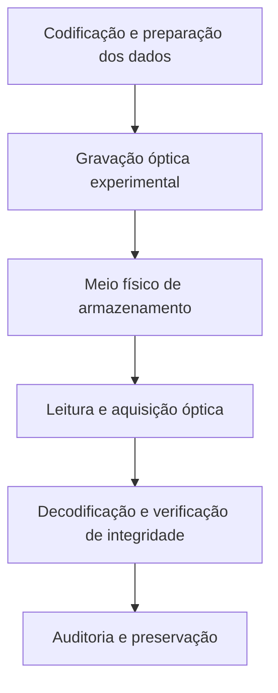

# Quartz 5D Sovereignty | Roteiro conceitual de apresentação

Este repositório reúne um roteiro de pitch sobre uma proposta de pesquisa em armazenamento de dados em materiais como cristal de quartzo, com referências a gravação óptica multidimensional e soberania de dados.

> **Maturidade:** material de apresentação conceitual. O conteúdo atual não demonstra um dispositivo de gravação/leitura, protótipo físico, método experimental validado, capacidade de armazenamento medida ou sistema operacional de armazenamento 5D. Alegações de durabilidade, densidade, segurança ou desempenho devem ser tratadas como hipóteses até que existam fontes científicas e resultados reproduzíveis.

## Objetivo

Organizar a narrativa do problema, hipótese tecnológica, possíveis aplicações, plano de pesquisa e necessidades de validação para futuras conversas com pesquisadores, universidades, laboratórios e potenciais parceiros.

## Conteúdo atual

O arquivo principal é `README.md`, estruturado como roteiro de apresentação por slides, com:
- contexto e motivação para preservação de dados;
- proposta conceitual de armazenamento em cristal;
- potenciais aplicações e benefícios pretendidos;
- narrativa para apresentação institucional.

Não há, no estado atual documentado, instruções de instalação ou execução de software.

## Arquitetura de pesquisa proposta

A seguinte decomposição é uma hipótese de trabalho, não uma arquitetura implementada:

## Plano de validação recomendado

1. Revisão bibliográfica por pares sobre armazenamento óptico multidimensional em materiais transparentes.
2. Definição de hipótese mensurável e protocolo experimental.
3. Identificação de laboratório, equipamento e material de referência.
4. Medição de densidade, taxa de gravação/leitura, taxa de erro e estabilidade.
5. Publicação de dados, código de análise e resultados reproduzíveis.
6. Revisão independente antes de qualquer alegação de prontidão tecnológica.

## Uso

Este repositório é documental. Para apresentar o projeto, utilize o roteiro como hipótese de pesquisa e mantenha explícita a distinção entre visão, experimento proposto e resultado validado.

## Contribuição

Contribuições devem incluir referências verificáveis, metodologia, unidade de medida e limitações. Não apresente resultados hipotéticos como experimentos realizados.

## Licença

Verifique a presença de um arquivo de licença antes de reutilizar ou redistribuir o conteúdo.
